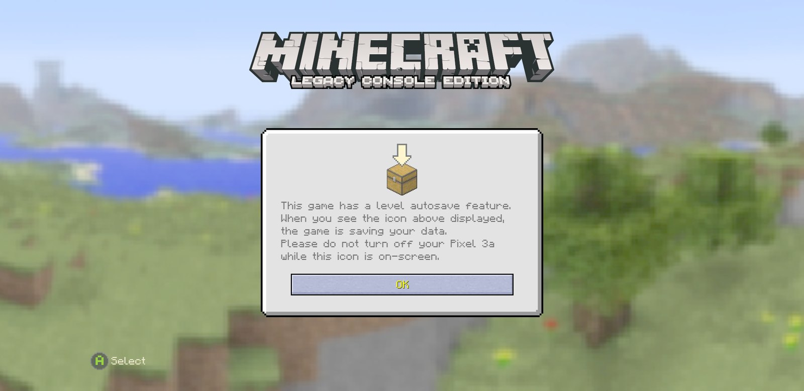
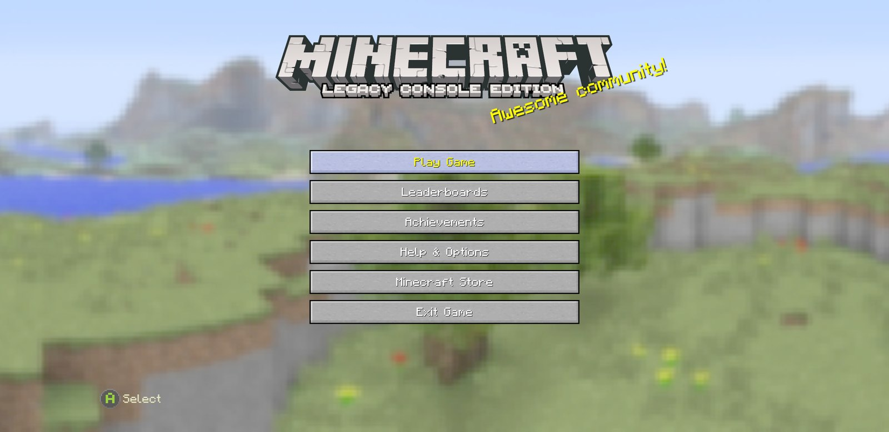
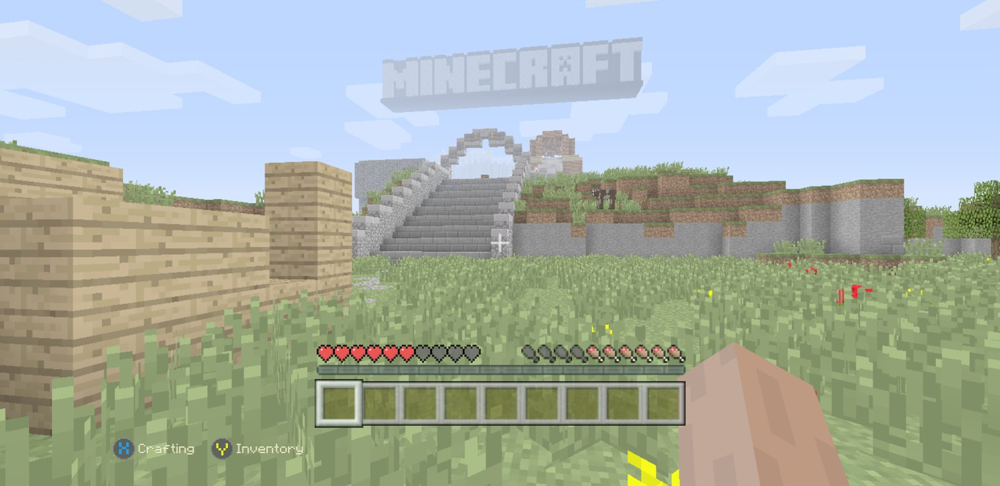
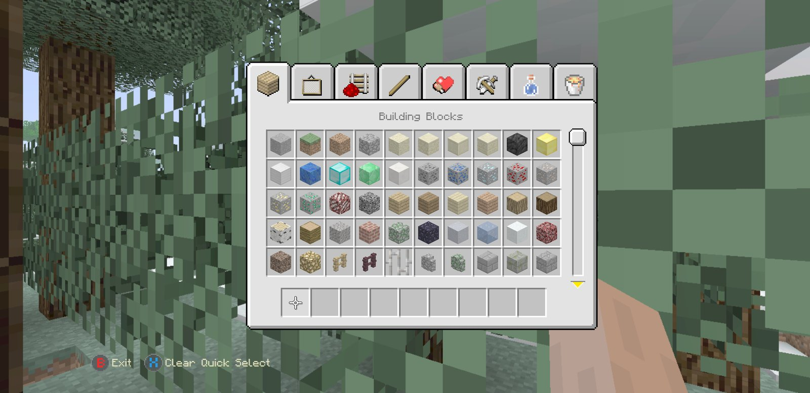

# MCLCE-Android

An Android port of the TU19 Legacy Console Edition. **Note that there are no Minecraft game files in this repo - you need to provide these.**

It shares most of its game code with [MCLCE-iOS](https://github.com/dtentiion/MCLCE-iOS), included as a submodule here, with just the bits which interact with the system differing - rendering, the application itself, input, audio and storage.

<p align="center">
  
  
  
  
</p>

## Current status

Early, but playable. All the features mentioned below have been tested on the one phone it has been tested on, though anything not mentioned may be untested.

- menus
- world creation, loading and saving
- survival and creative modes
- crafting
- the tutorial
- texture packs

There is no multiplayer, same as for the iOS version.

## How to play

Using a controller (either Xbox or PlayStation should do, other types should too) - there is no facility for using the screen.

## Requirements

- a 64-bit ARM based phone/tablet running Android 8.0 or later
- a graphics processor with Vulkan support (used for rendering the menus)
- a controller

Only tested on a Pixel 3a.

## What's in the package

- the TU19 and the iOS version's game code, compiled using the NDK
- an implementation of the same rendering API used by the iOS version, based on OpenGL ES 3.0 rather than Metal
- the game's Flash (`.swf`) menus, displayed using the same variant of [Ruffle](https://ruffle.rs/) used by the iOS version, in the `third_party/ruffle_android/` directory
- audio using [miniaudio](https://miniaud.io)
- input from Android's gamepad events

## Building

You'll need the Android SDK with NDK 27.2 and CMake 3.22, JDK 17, Rust with the `aarch64-linux-android` target, Python 3 and bash (Git Bash will do on Windows).

```
git clone --recursive https://github.com/dtentiion/MCLCE-Android.git
cd MCLCE-Android
bash scripts/patch-upstream.sh
bash scripts/build-ruffle.sh
./gradlew assembleRelease
```

The resulting APK can be found in `app/build/outputs/apk/release/`.

## Installing

See [INSTALL.md](INSTALL.md)

## Contributing

In a similar fashion to the iOS version:

- changes should be as close as possible to the TU19 Legacy Console Edition source
- they should be as small and discrete as possible
- any game related material shouldn't be added to the repository

Any files in the `ios/` directory belong to the iOS version, and should be edited there.

## Legal

This is an unofficial port of TU19 Legacy Console Edition to Android. Minecraft is a trademark of Mojang AB / Microsoft. This project has no affiliation whatsoever with Mojang, Microsoft, or 4J Studios. **You need to provide your own game files - none are included in this repository.**
